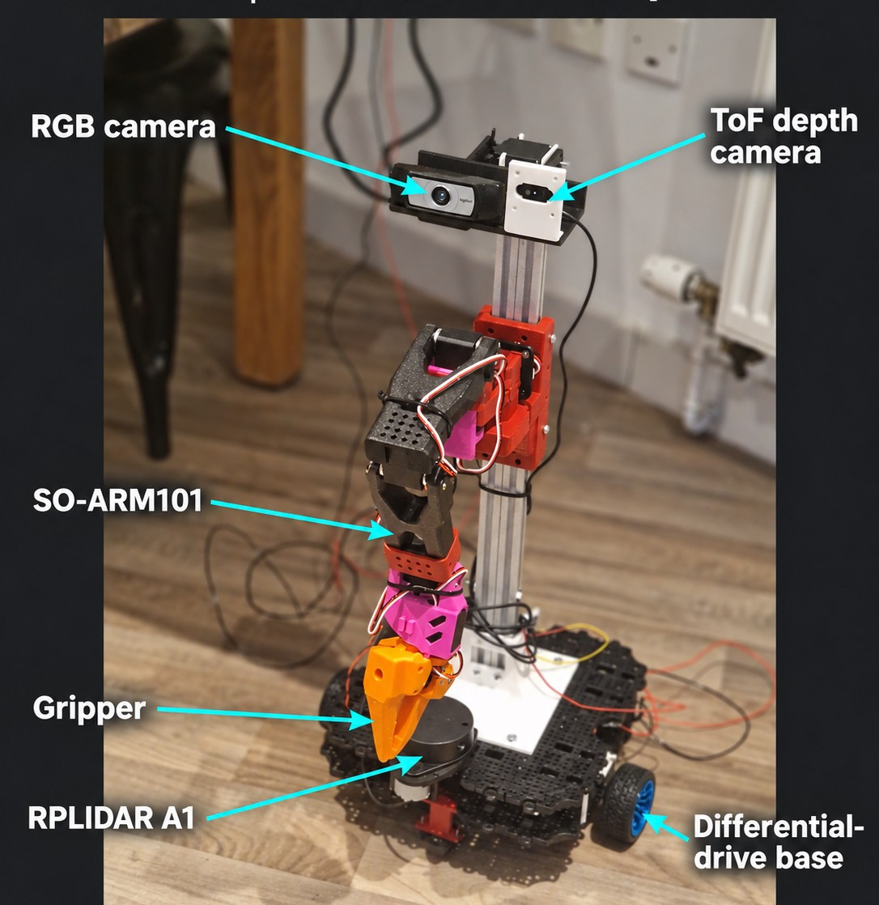

# Homer | ROS 2 mobile manipulator

Homer is a low-cost mobile manipulator that brings an ESP32 drive base, a
Raspberry Pi, and a SO-ARM 101 together as one ROS 2 robot. The project explores
the full path from embedded motor control and teleoperation to perception,
mapping, and manipulation.



**The goal:** find an object, approach it, and grasp it. The robot is under
active development; autonomous approach and grasping are not yet demonstrated.

| | |
| --- | --- |
| **Robot software** | ROS 2 Jazzy · Raspberry Pi · ESP32 · Python · C++ |
| **Hardware** | Differential-drive base · SO-ARM 101 · RPLIDAR A1 · RGB and ToF cameras |
| **Engineering focus** | Safe control · sensor integration · calibration · simulation |

## What’s here

- **Robot control:** ESP32 firmware for the drive base, encoder odometry, neck
  servo, and a bounded serial protocol; ROS 2 bridges and dead-man gamepad
  controls run on the Pi.
- **Navigation and sensing:** LiDAR mapping support, RGB object detection,
  camera/ToF experiments, and recorded evidence for unresolved range and
  clearance questions.
- **Manipulation research:** SO-ARM 101 control, workspace modelling, and an
  experimental ACT policy path. Automated grasping remains a work in progress.
- **Simulation and calibration:** a PyBullet model, reachable-workspace
  analysis, measured encoder notes, and procedures for checking robot-specific
  geometry.

Start with the [system architecture and ROS graph](docs/architecture/README.md),
or try the [hardware-free simulation](simulation/README.md).

This is an engineering project for one physical robot, not a ready-to-run kit.
Wiring, device paths, controller mappings, servo calibration, and clearances
must be checked on the target machine.

## Safety and evidence

Do not enable motion from a fresh checkout. Test with the drive wheels lifted,
the arm supported, and an accessible emergency power disconnect. Verify the
controller mapping, USB device identities, motor wiring, and power capacity
first. Claims marked `REQUIRES_HARDWARE_TEST` still need the stated physical
check.

The reachable-workspace visualisation is a model-derived planning aid, not a
motion command or proof that a physical move is safe. The current arm mount
cannot reach the floor, so workspace and grasp tests use a raised rigid
platform.

## Project map

| Area | Purpose | Starting point |
| --- | --- | --- |
| ESP32 firmware | Drive, encoders, odometry, neck, serial link | [`firmware/`](firmware/) |
| Raspberry Pi runtime | ROS bridges, services, sensors, diagnostics | [`pi/`](pi/) |
| Gamepad teleoperation | Dead-man controls and command routing | [`pi/robot_teleop/`](pi/robot_teleop/) |
| Simulation | PyBullet robot and workspace/LiDAR experiments | [`simulation/`](simulation/) |
| Documentation | ROS graph, calibration, controls, evidence | [`docs/`](docs/) |

## Bill of Materials (BOM)

| Component | Qty | Cost | Link |
|---|---:|---:|---|
| FEETECH SO-ARM101 | 1 | £93.24 | [AliExpress purchase listing](https://www.aliexpress.com/item/1005013035691637.html) |
| RPLidar A1M8 | 1 | £93.00 | [RobotShop](https://uk.robotshop.com/products/rplidar-a1m8-360-degree-laser-scanner-development-kit) |
| Arducam ToF Camera | 1 | £51.50 | [Pi Hut](https://thepihut.com/products/time-of-flight-camera-for-raspberry-pi) |
| BNO085 IMU | 1 | £20.90 | [Amazon](https://www.amazon.co.uk/dp/B0GXZNT84M) |
| Waveshare Servo Driver | 1 | £9.99 | [Amazon](https://www.amazon.co.uk/dp/B0CJ6TP3TP) |
| Drive motor and wheel kit | 1 | Price not recorded | [Amazon](https://www.amazon.co.uk/dp/B07WRYQZNR) |
| DC Buck Converter | 1 | £4.99 | [Amazon](https://www.amazon.co.uk/dp/B07DK6WN63) |
| Motor Driver | 1 | £6.81 | — |
| Caster Wheels | 4 | £2.99 | [Amazon](https://www.amazon.co.uk/dp/B0GH2LKD9Q) |
| ESP32 DevKit | 1 | £5.99 | [Amazon](https://www.amazon.co.uk/dp/B0CJHR8SMK) |
| OV9732 Camera | 1 | £4.32 | — |
| XT60-JST Cables | 4 | £6.59 | [Amazon](https://www.amazon.co.uk/dp/B0DDC9WM6N) |
| Silicone Wire | 5 m | £4.99 | [Amazon](https://www.amazon.co.uk/dp/B0G2SL4NGQ) |
| Battery pack | 1 | Price not recorded | [Amazon](https://www.amazon.co.uk/dp/B0D3Y3ZRBK) |
| Raspberry Pi 4 Model B (2 GB, typical new price) | 1 | £50.85 | [DigiKey](https://www.digikey.co.uk/en/product-highlight/r/raspberry-pi/raspberry-pi-4-model-b) |
| Aluminium extrusion frame | 1 | Free (provided by university) | [Example 2020 profile](https://www.123-3d.co.uk/123-3D-Aluminium-profile-2020-black-1m-length-123-3D-brand-HFSB5-2020-1000-i3765.html) |
| Logitech RGB camera | 1 | Used, bought on eBay; price not recorded | [eBay listings](https://www.ebay.co.uk/sch/i.html?_nkw=Logitech+RGB+webcam) |
| 3D-printed parts and fasteners | Mixed | Not recorded | — |
| **Subtotal of recorded costs** | | **£356.16** | |

The robot runs without a battery management system (BMS), so it is not included.

## System architecture

See the [architecture diagrams](docs/architecture/README.md) for the Pi boot
services, ROS topics, ESP32 and arm control, sensors, and LiDAR scan watchdog.
Start with the [ESP32 loop](firmware/src/main.cpp),
[Pi serial bridge](pi/esp32_serial_bridge.py), and
[boot installer](pi/install-boot-services.sh). Fixed Pi hardware paths live in
[`pi/device_paths.py`](pi/device_paths.py); see the
[device map](pi/README.md#device-identities-and-usb-safety) before changing cables.

## Quick start

### Run the simulation

The simulator has no ROS or hardware dependency. From the repository root:

```bash
python3 -m pip install --user pybullet
python3 simulation/pybullet_sim.py --seconds 20
```

Use `--gui`, `--2d`, `--2d-live`, or `--2d-gui` for visual modes. See the
[simulation guide](simulation/README.md) for dependencies and options.

### Inspect the arm workspace

The workspace view samples the calibrated URDF, excludes points behind the
robot, and rejects configurations colliding with the modelled mast, base,
arm mount, or neck:

```bash
python3 simulation/pybullet_sim.py --workspace --gui --seconds 60
```

Use the PyBullet right-panel camera controls, especially **Camera yaw (turn
around)**, to inspect all sides of the model. For assumptions, limitations,
and the required physical validation procedure, see
[reachable-workspace characterisation](docs/calibration/reachable-workspace.md).

### Build ESP32 firmware

The ESP32 is built with Arduino CLI and connects to a ROS 2 bridge on the Pi
through a compact serial protocol.
The `esp32dev` production image provides drive-mode selection, encoder
odometry, neck control, drive status, and a one-second command safety timeout.
Standalone diagnostic targets deliberately bypass parts of that runtime; use
them only with the matching physical checks and safety setup.

1. Install [Arduino CLI](https://arduino.github.io/arduino-cli/) and ensure it
   is available on your `PATH`:

   ```bash
   arduino-cli version
   ```

2. From the repository root, install the pinned ESP32 core and Python `pyserial`
   build dependency. The first run downloads
   the toolchain and may take a few minutes:

   ```bash
   ./bootstrap-arduino-cli.sh
   ```

3. Build the production firmware:

   ```bash
   ./build.sh esp32dev
   ```

   The flashable images are written to `build/esp32dev/`:

   ```text
   firmware.ino.bin
   firmware.ino.bootloader.bin
   firmware.ino.partitions.bin
   ```

The project currently pins Arduino-ESP32 2.0.2. Build the standalone diagnostics
with one of these commands:

```bash
./build.sh servo_sweep
./build.sh servo_idle
./build.sh motor_diagnostic
```

These targets intentionally bypass parts of the full runtime. Use them
only with the matching physical checks and safety setup.

Install the [Pi runtime](pi/README.md#automatic-startup) first; the flash
script requires its ESP32 device link. Then, to build and flash the ESP32
connected to its fixed Pi USB port:

```bash
./deploy.sh esp32dev
```

[`deploy.sh`](deploy.sh) builds locally, saves the previous image on the Pi,
flashes the ESP32, and switches from the micro-ROS Agent to the serial ROS
bridge. It uses the ESP32 runtime link, which points to the fixed physical
USB path in [`pi/device_paths.py`](pi/device_paths.py). The bridge expects an
ESP32 HOM1 greeting but **does not search other serial ports**. Review the
script and verify the physical port mapping before flashing; both USB serial
adapters report the same by-id serial number.

### Prepare the Pi runtime

The Pi services and their verification commands are documented in the
[Pi runtime guide](pi/README.md). The gamepad coordinator has its own
[installation and mapping guide](pi/robot_teleop/README.md).

The active joystick path is `gamepad-joy.service` → `/joy` →
`robot-teleop.service`. It publishes `/teleop/cmd_vel`,
`/soarm/command_delta_ticks`, `/teleop/neck_angle`, and `/set_autonomous`.
The canonical control map and pre-motion checks are in
[`docs/gamepad-control-map.md`](docs/gamepad-control-map.md). The older
`gamepad_teleop.py` / `gamepad-teleop.service` path has a different mapping
and must not run at the same time.

With the production image, verify that the ESP32 ROS interfaces are available:

```bash
source /opt/ros/jazzy/setup.bash
systemctl --user is-active esp32-serial-bridge.service
ros2 topic list | grep -E '^/(cmd_vel|teleop/cmd_vel|odom|drive/status)$'
ros2 topic echo /drive/link std_msgs/msg/Bool --once --qos-durability transient_local
```

The Pi bridge publishes `/odom`, `/drive/status`, and `/drive/link`, and
subscribes to `/cmd_vel`, `/teleop/cmd_vel`, `/set_autonomous`,
`/mode_override`, and `/teleop/neck_angle`. The ESP32 uses a bounded HOM1
serial protocol and retains the one-second motor command timeout.

The [ROS and service diagrams](docs/architecture/README.md) show the main
runtime flow, including the LiDAR watchdog. Normal routing selects
`/teleop/cmd_vel` when `/set_autonomous` is `false`, and `/cmd_vel` when it is
`true`. Terminal override changes that routing as described below.

### Terminal drive override

`/mode_override` is the highest-priority drive-mode gate. It is intended for
direct terminal control and prevents `/set_autonomous` from changing the
selected mode while active. Its `std_msgs/msg/Int32` values are:

| Value | Meaning |
| --- | --- |
| `0` | Enable override and show TELEOP mode. |
| `1` | Enable override and show AUTONOMOUS mode. |
| `2` | Enable override in STOPPED mode; wheel commands are rejected. |
| Negative (normally `-1`) | Clear override and return to TELEOP mode. |

With override set to `0` or `1`, only `/cmd_vel` is accepted for wheel
commands; `/teleop/cmd_vel` is ignored. The Pi coordinator can therefore keep
publishing its mode selection without taking over the terminal command stream.
Always publish a zero command before clearing override:

```bash
source /opt/ros/jazzy/setup.bash
ros2 topic pub --once /mode_override std_msgs/msg/Int32 '{data: 0}'
ros2 topic pub -r 10 /cmd_vel geometry_msgs/msg/Twist \
  '{linear: {x: 0.7}, angular: {z: 0.0}}'
# Stop the publisher with Ctrl-C, then explicitly stop and release override.
ros2 topic pub --once /cmd_vel geometry_msgs/msg/Twist \
  '{linear: {x: 0.0}, angular: {z: 0.0}}'
ros2 topic pub --once /mode_override std_msgs/msg/Int32 '{data: -1}'
```

After release, the firmware initially selects TELEOP, but the running Pi
coordinator may select AUTONOMOUS again on its next mode heartbeat.

## Development checks

Run the coordinator tests without ROS or hardware:

```bash
PYTHONPATH=pi/robot_teleop/src python3 -m unittest discover -s pi/robot_teleop/tests -v
```

For any firmware or runtime change, also check the relevant physical interface
on the robot with motion inhibited before attempting a lifted-wheel test.

## Documentation map

- [System architecture and watchdog diagrams](docs/architecture/README.md)
- [Gamepad controls and safety checks](docs/gamepad-control-map.md)
- [Reachable-workspace characterisation](docs/calibration/reachable-workspace.md)
- [Raspberry Pi runtime](pi/README.md)
- [ESP32 serial protocol and bridge](docs/esp32-serial-bridge.md)
- [Gamepad coordinator](pi/robot_teleop/README.md)
- [Simulation](simulation/README.md)

For a new contributor, the recommended reading order is this file, then the
[simulation guide](simulation/README.md), then the relevant Pi or calibration
guide. Search for `REQUIRES_HARDWARE_TEST` before treating a result as a
validated robot capability.

## Contributing

Keep changes small and reviewable, avoid committing generated files or
credentials, and document any robot-specific calibration change with its
measurement source. Do not merge or deploy motion-related changes without a
proportionate hardware safety check.
