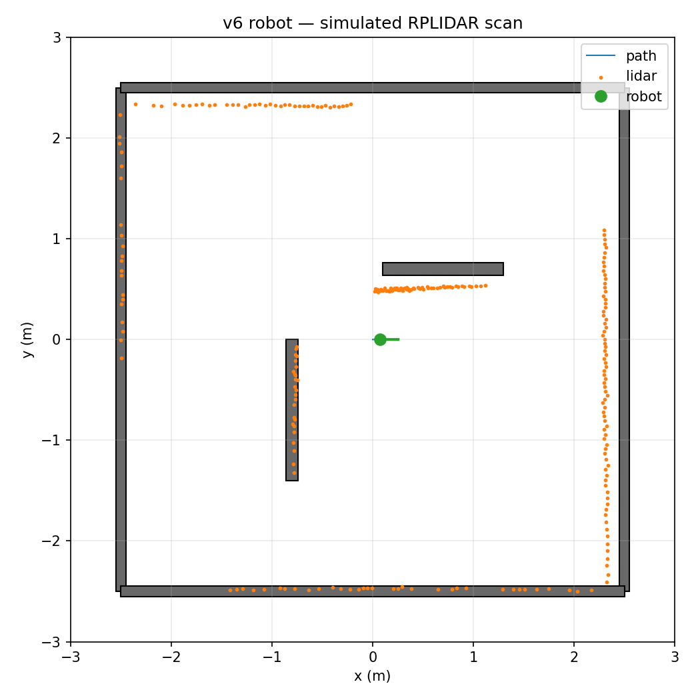
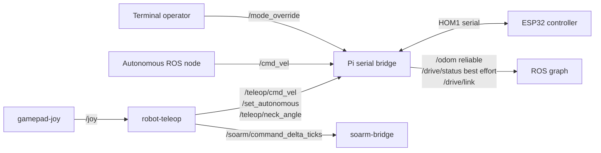

# Homer mobile manipulator

Homer is a custom mobile manipulator built around an ESP32, Raspberry Pi,
ROS 2 Jazzy, differential-drive base, SO-ARM 101, and RPLIDAR A1. This
repository contains the firmware, Raspberry Pi integration, operator controls,
calibration material, and PyBullet simulation for that robot.

This is an active engineering repository for one physical robot. It is not a
ready-to-run robot kit: several values still depend on the wiring, controller,
servo calibration, and clearances of the target machine.

## Read this first

The current work is split into two related areas:

- **Arm safety baseline:** named SO-ARM poses and slow, repeatable motion are
  still the first physical prerequisite for automated grasping.
- **Reachable-workspace model:** the repository generates a conservative
  workspace estimate from the calibrated URDF. It helps compare target
  positions with the model; it does not authorise a physical move.

Words such as `REQUIRES_HARDWARE_TEST` mean that software checks cannot prove
the claim. Do not replace that marker with a success claim unless the stated
physical test has actually been performed and recorded.

> **Hardware safety:** do not enable motion from a fresh checkout. Test with
> the drive wheels lifted, the arm supported, and an accessible emergency power
> disconnect. Confirm controller mappings, USB device identities, motor wiring,
> and power capacity on the specific robot first.

## What lives here

| Area | Purpose | Starting point |
| --- | --- | --- |
| ESP32 firmware | serial link, drive control, encoders, odometry, neck servo | [`firmware/`](firmware/) |
| Raspberry Pi runtime | serial ROS bridge, SO-ARM bridge, LiDAR support | [`pi/`](pi/) |
| Gamepad coordinator | dead-man controls and ROS command translation | [`pi/robot_teleop/`](pi/robot_teleop/) |
| Simulation | PyBullet model with simulated odometry and LiDAR | [`simulation/`](simulation/) |
| Operator controls | control map and pre-motion checks | [`docs/gamepad-control-map.md`](docs/gamepad-control-map.md) |

## Status and safety

This is an integration project for one physical robot, not a general-purpose
robot distribution. Hardware calibration, controller mappings, serial-device
names, and wiring must be checked on the target robot before deployment. Drive
calibration and SO-ARM EEPROM travel limits are robot-specific.

The reachable-workspace visualisation is a model-derived planning aid. It is
not a motion command or proof that a physical move is safe. Before a workspace
region is used for planning, physically check the raised platform position,
clearances, and servo-to-URDF calibration. The current robot cannot reach the
floor from its present arm mount, so workspace and grasp tests use a raised
rigid platform only.

## Quick start

### Visual preview

The repository includes this generated simulation preview so readers can see
what the lightweight LiDAR test produces. It is simulation output, not a
photograph or physical validation result.



### Run the simulation

The simulator has no ROS or hardware dependency. From the repository root:

```bash
python3 -m pip install --user pybullet
python3 simulation/pybullet_sim.py --seconds 20
```

Use `--gui`, `--2d`, `--2d-live`, or `--2d-gui` for visual modes. See the
[simulation guide](simulation/README.md) for dependencies and options.

### Inspect the arm workspace

The workspace view samples the calibrated URDF, excludes points behind the
robot, and rejects configurations colliding with the modelled mast, base,
arm mount, or neck:

```bash
python3 simulation/pybullet_sim.py --workspace --gui --seconds 60
```

Use the PyBullet right-panel camera controls, especially **Camera yaw (turn
around)**, to inspect all sides of the model. For assumptions, limitations,
and the required physical validation procedure, see
[reachable-workspace characterisation](docs/calibration/reachable-workspace.md).

### Build ESP32 firmware

The ESP32 is built with Arduino CLI and connects to a ROS 2 bridge on the Pi
through a compact serial protocol.
The `esp32dev` production image provides drive-mode selection, encoder
odometry, neck control, drive status, and a one-second command safety timeout.
Standalone diagnostic targets deliberately bypass parts of that runtime; use
them only with the matching physical checks and safety setup.

1. Install [Arduino CLI](https://arduino.github.io/arduino-cli/) and ensure it
   is available on your `PATH`:

   ```bash
   arduino-cli version
   ```

2. From the repository root, install the pinned ESP32 core and Python `pyserial`
   build dependency. The first run downloads
   the toolchain and may take a few minutes:

   ```bash
   ./bootstrap-arduino-cli.sh
   ```

3. Build the production firmware:

   ```bash
   ./build.sh esp32dev
   ```

   The flashable images are written to `build/esp32dev/`:

   ```text
   firmware.ino.bin
   firmware.ino.bootloader.bin
   firmware.ino.partitions.bin
   ```

The project currently pins Arduino-ESP32 2.0.2. Build the standalone diagnostics
with one of these commands:

```bash
./build.sh servo_sweep
./build.sh servo_idle
./build.sh motor_diagnostic
```

These targets intentionally bypass parts of the full runtime. Use them
only with the matching physical checks and safety setup.

To build and flash the ESP32 connected to the Pi's discovered serial port:

```bash
./deploy.sh esp32dev
```

[`deploy.sh`](deploy.sh) builds locally, saves the previous image on the Pi,
flashes the ESP32, and switches from the micro-ROS Agent to the serial ROS
bridge. The bridge identifies the ESP32 by its HOM1 greeting and maintains
the runtime device link. Review the
script and confirm the discovered serial device before running it.

### Prepare the Pi runtime

The Pi services and their verification commands are documented in the
[Pi runtime guide](pi/README.md). The gamepad coordinator has its own
[installation and mapping guide](pi/robot_teleop/README.md).

With the production image, verify that the ESP32 ROS interfaces are available:

```bash
source /opt/ros/jazzy/setup.bash
systemctl --user is-active esp32-serial-bridge.service
ros2 topic list | grep -E '^/(cmd_vel|teleop/cmd_vel|odom|drive/status)$'
ros2 topic echo /drive/link std_msgs/msg/Bool --once --qos-durability transient_local
```

The Pi bridge publishes `/odom`, `/drive/status`, and `/drive/link`, and
subscribes to `/cmd_vel`, `/teleop/cmd_vel`, `/set_autonomous`,
`/mode_override`, and `/teleop/neck_angle`. The ESP32 uses a bounded HOM1
serial protocol and retains the one-second motor command timeout.

### ROS topic graph



Normal routing selects `/teleop/cmd_vel` when `/set_autonomous` is `false`,
and `/cmd_vel` when it is `true`. Terminal override changes that routing as
described below.

### Terminal drive override

`/mode_override` is the highest-priority drive-mode gate. It is intended for
direct terminal control and prevents `/set_autonomous` from changing the
selected mode while active. Its `std_msgs/msg/Int32` values are:

| Value | Meaning |
| --- | --- |
| `0` | Enable override and show TELEOP mode. |
| `1` | Enable override and show AUTONOMOUS mode. |
| `2` | Enable override in STOPPED mode; wheel commands are rejected. |
| Negative (normally `-1`) | Clear override and return to TELEOP mode. |

With override set to `0` or `1`, only `/cmd_vel` is accepted for wheel
commands; `/teleop/cmd_vel` is ignored. The Pi coordinator can therefore keep
publishing its mode selection without taking over the terminal command stream.
Always publish a zero command before clearing override:

```bash
source /opt/ros/jazzy/setup.bash
ros2 topic pub --once /mode_override std_msgs/msg/Int32 '{data: 0}'
ros2 topic pub -r 10 /cmd_vel geometry_msgs/msg/Twist \
  '{linear: {x: 0.7}, angular: {z: 0.0}}'
# Stop the publisher with Ctrl-C, then explicitly stop and release override.
ros2 topic pub --once /cmd_vel geometry_msgs/msg/Twist \
  '{linear: {x: 0.0}, angular: {z: 0.0}}'
ros2 topic pub --once /mode_override std_msgs/msg/Int32 '{data: -1}'
```

After release, the firmware initially selects TELEOP, but the running Pi
coordinator may select AUTONOMOUS again on its next mode heartbeat.

## Development checks

Run the coordinator tests without ROS or hardware:

```bash
PYTHONPATH=pi/robot_teleop/src python3 -m unittest discover -s pi/robot_teleop/tests -v
```

For any firmware or runtime change, also check the relevant physical interface
on the robot with motion inhibited before attempting a lifted-wheel test.

## Repository map

| Path | Contents |
| --- | --- |
| `firmware/` | Arduino CLI sketch and ESP32 firmware for the base, encoders, odometry, neck servo, and serial link |
| `pi/` | Raspberry Pi services, ROS bridges, diagnostics, and tests |
| `simulation/` | PyBullet robot model and workspace/LiDAR simulation |
| `config/` | Measured or pending calibration values; `null` means not measured |
| `docs/` | Operator controls and physical calibration procedures |

## Documentation map

- [Gamepad controls and safety checks](docs/gamepad-control-map.md)
- [Reachable-workspace characterisation](docs/calibration/reachable-workspace.md)
- [Raspberry Pi runtime](pi/README.md)
- [Gamepad coordinator](pi/robot_teleop/README.md)
- [Simulation](simulation/README.md)

For a new contributor, the recommended reading order is this file, then the
[simulation guide](simulation/README.md), then the relevant Pi or calibration
guide. Search for `REQUIRES_HARDWARE_TEST` before treating a result as a
validated robot capability.

## Contributing

Keep changes small and reviewable, avoid committing generated files or
credentials, and document any robot-specific calibration change with its
measurement source. Do not merge or deploy motion-related changes without a
proportionate hardware safety check.
