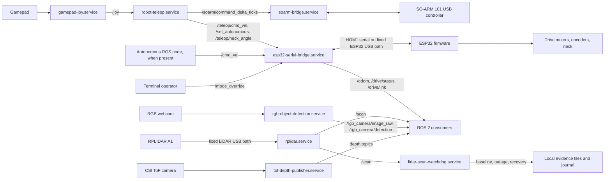
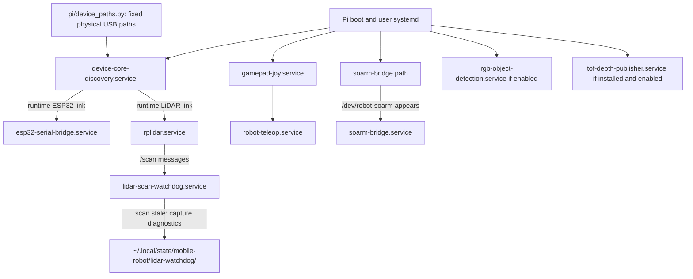

# Robot system architecture

This page shows the robot's runtime components. For installation commands and fixed USB
paths, use the [Pi runtime guide](../../pi/README.md); for building and
flashing, use the [main README](../../README.md#build-esp32-firmware).

## Data and control flow

The ESP32 bridge routes either `/teleop/cmd_vel` or `/cmd_vel` according to
the selected mode; `/mode_override` takes priority. The ESP32 has a one-second
motor-command timeout. The SO-ARM bridge starts only when `/dev/robot-soarm`
appears. The ToF publisher's implementation is outside this repository.
The RGB service can be disabled for diagnosis and is not required for LiDAR
scans. The ToF path is optional when its separate service is installed.

## Boot and fault observation

Discovery checks paths without opening serial devices. The ESP32 bridge opens
only its fixed port; the LiDAR driver alone opens the LiDAR port. The watchdog
starts with the Pi, allows 60 seconds for startup, then reports 15 seconds
without `/scan`. It takes a healthy baseline and, during an outage, saves at
most one snapshot per minute (latest 30 retained). Each snapshot includes
service states, ROS graph, serial ownership, USB state, Pi temperature and
throttling, relevant processes, and recent logs. Recovery is logged, but the
watchdog does **not** restart anything.

Check the live system with `systemctl --user status lidar-scan-watchdog.service`
and `journalctl --user -u lidar-scan-watchdog.service -b`. The [Pi runtime
guide](../../pi/README.md#device-identities-and-usb-safety) lists the exact
device paths and safe verification commands.
