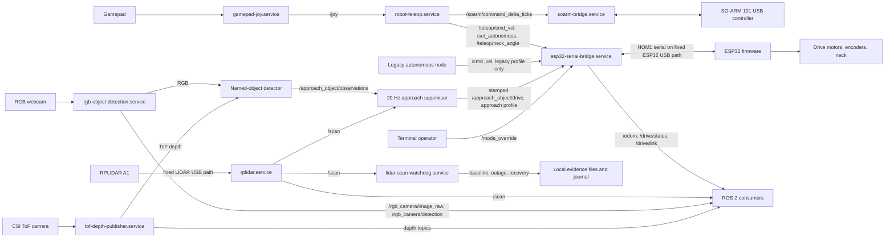
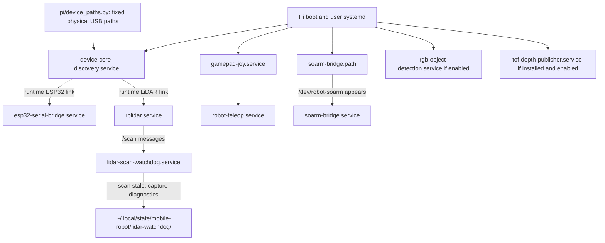

# Robot system architecture

This page shows the robot's runtime components. For installation commands and fixed USB
paths, use the [Pi runtime guide](../../pi/README.md); for building and
flashing, use the [main README](../../README.md#build-esp32-firmware).

## Named floor-object approach — REQUIRES_HARDWARE_TEST

The current task is to find a stationary **bottle or cup on a level floor**, check
up to two tilt views, approach on a clear path and stop **30 ±5 cm from the nearest
surface, measured from the robot's front edge**. SLAM, exploration and pickup are
outside this task. Notify the operator before issuing any base or camera-tilt
motion command.

Implementation lives in `pi/approach_object` and `pi/approach_object_interfaces`.
The detector subscribes to the existing RGB/ToF publishers; it never opens a
camera or commands the base. It uses YOLO11n-seg masks at 320 pixels, erodes mask
boundaries, projects millimetre ToF samples through measured intrinsics and
extrinsics, and rejects invalid, floor-contaminated or inconsistent samples.
Range interpretation (`optical_z` versus `radial`) must be measured. A nearest
reliable surface estimate subtracts the measured base-frame front edge.

The supervisor runs at 20 Hz. `/approach_object/start` accepts `bottle` or `cup`;
`/approach_object/cancel` stops the task. `/approach_object/status` is JSON with
state, target, clearance in metres, view and reason. Search holds the base still,
waits for measured settling, and requires three fresh observations. It selects
the matching object closest to image centre and retains its identity; ambiguous
associations fail. State flow is IDLE → SEARCH → ALIGN → APPROACH → STOPPED, with
latched FAILED/CANCELLED states. Target/depth loss, stale perception, lidar
blockage and teleop takeover require explicit restart. No retries or reversals.

The bridge's `approach_mode:=true` profile removes its `/cmd_vel` subscription.
Only stamped `/approach_object/drive` requests enter the autonomous path, with a
250 ms local lease and 50 ms expiry checks. Expiry sends zero and stays latched
until an explicit operator mode cycle. `/drive/approach_authority` reports the
bridge gate. Starting a task never selects autonomous mode. Teleop, mode override,
neck and arm interfaces remain available. This controls ordinary ROS command
routing; access to the trusted ROS domain remains an operator responsibility.
The firmware's existing one-second timeout remains the fallback if the entire
serial bridge fails; bridge-local expiry covers supervisor failure.

### Calibration and movement gate

`config/calibration.yaml` ships with `enable_motion: false`, missing measurements
and all qualification flags false. Start requests fail until measured calibration
is provided. The two provisional servo commands (90°/130°) are within 80–150°;
they are **not measured camera pitches or qualified viewing angles**. No physical
motion, firmware flashing or live service changes were performed for this task.

Record RGB/ToF K matrices and distortion, optical ToF→RGB transform, optical
ToF→base transforms at both views, settling times, image buffering bound, depth
range semantics and validated limits. Base coordinates are x forward, y left,
z up; optical coordinates are x right, y down, z forward. Rigid transforms map
column-vector source points into destination coordinates. Record the front edge,
lidar→base transform, full-circle scan coverage, corridor half-width/front limit
and the complete turning swept radius. Unknown forward lidar beams block motion;
turning additionally requires valid coverage around the robot.

Independently measure the signed forward/left-turn serial command mappings,
actual speed (at most 0.05 m/s), braking travel and distance uncertainty. Command
values are not assumed to be metres per second. Positive drive previously moved
backwards; do not infer polarity or reuse failed automatic distance tests.
Uncertainty must cover travel during the maximum 500 ms perception age, 250 ms
lease and 50 ms supervision delay. Braking plus uncertainty must fit the 5 cm
stopping allowance; otherwise reduce speed/latency. Benchmark flags alone cannot
qualify the camera pose, tape distance or final stopping accuracy.

Before enabling movement, exercise both camera views with motor output physically
blocked, including absent/multiple targets, camera/depth loss and process death.
Validate stationary object clearance against tape measurements, especially near
30 cm. Then use short operator-observed movements to qualify polarity, turning
and braking before bottle/cup approaches, cancellation, takeover and blocked-path
checks. Record every measured configuration, result and failure here. Final
acceptance still requires centred target, no contact, no unintended reversal and
explicit restart after faults.

### Build, model export and launch

On the Pi, keep the detector environment separate from capture services:

```bash
python3 -m venv --system-site-packages ~/homer-approach-venv
~/homer-approach-venv/bin/pip install -r ~/mobile-robot/pi/approach_object/requirements-pi.lock
source /opt/ros/jazzy/setup.bash
mkdir -p ~/homer_approach_ws/src
cp -a ~/mobile-robot/pi/approach_object ~/mobile-robot/pi/approach_object_interfaces ~/homer_approach_ws/src/
cd ~/homer_approach_ws
colcon build --symlink-install --packages-select approach_object_interfaces approach_object
source install/setup.bash
```

The workstation export uses `requirements-workstation.lock` (CPU Torch wheels
from `https://download.pytorch.org/whl/cpu`). Download the Linux binary from
[PNNX 20250912](https://github.com/pnnx/pnnx/releases/tag/20250912), place `pnnx`
in a separate export directory, make it executable, and run
`pi/approach_object/tools/export_model.py` using that environment. The script
checks source weights and PNNX hashes before export. Model hashes/revisions are
recorded in `config/model-manifest.json` and checked by `model_pin.py`; binary
artifacts are kept outside Git. NCNN export support is described by
[Ultralytics](https://docs.ultralytics.com/integrations/ncnn/).

Staged Pi model: `~/homer-approach-models/yolo11n-seg_ncnn_model`.
Read-only benchmark command (does not open cameras or publish commands):

```bash
source /opt/ros/jazzy/setup.bash
PYTHONPATH=~/homer_approach_ws/src/approach_object:$PYTHONPATH ~/homer-approach-venv/bin/python ~/homer_approach_ws/src/approach_object/tools/benchmark.py ~/homer-approach-models/yolo11n-seg_ncnn_model --image ~/homer-evidence/approach-object/rgb.png --output ~/homer-evidence/approach-object/benchmark.json
```

For later supervised deployment, copy the reviewed bridge and `autonomous_lease.py`
together to `~/mobile-robot/pi`. Install `tools/bridge-approach.conf` as
`~/.config/systemd/user/esp32-serial-bridge.service.d/approach.conf`, reload systemd
and restart the bridge only after notifying the operator. Preserve any existing
service/network overrides. Capture-owner timestamp improvements in RGB and ToF
are staged source changes; deploy them with the same capture services, never a
second capture process.

Launch the two task processes after sourcing the detector environment and ROS
workspace. Operator notification is required before a qualified start because
search commands camera tilt:

```bash
source ~/homer-approach-venv/bin/activate
source /opt/ros/jazzy/setup.bash
source ~/homer_approach_ws/install/setup.bash
ros2 launch approach_object approach.launch.py model:=$HOME/homer-approach-models/yolo11n-seg_ncnn_model calibration:=$HOME/homer_approach_ws/src/approach_object/config/calibration.yaml
ros2 service call /approach_object/start approach_object_interfaces/srv/StartApproach '{target: bottle}'
ros2 service call /approach_object/cancel std_srvs/srv/Trigger '{}'
```

With the shipped configuration the start service refuses movement. Use a copied,
measured configuration for qualification; never enable by changing flags alone.
The launcher does not start a second serial bridge or change operator mode.

Rollback: cancel the task and stop its two processes, select operator teleop,
remove only the `approach.conf` drop-in, reload systemd and restart the bridge.
Restore the saved capture-owner/bridge source versions if deployed. No firmware
changes are required. The staged code has not been installed into live services.

### Results and outstanding qualification (2026-10-04)

Feature branch: `approach-named-floor-object`, based on `origin/main` at
`dc666cc`. ROS Jazzy packages built on the Pi. Hardware-free tests exercise the
real bridge/service handlers with fake plumbing and synthetic sensor messages;
46 task tests plus 5 existing RGB/protocol regression tests passed on the Pi. Tests cover depth units/projection, contamination,
identity ambiguity, state transitions, cancellation, stale inputs, lidar coverage,
command expiry, bypass prevention, model checksums and image stride/endianness.

Existing RGB and ToF capture owners remain active. RGB stamps now occur directly
after retrieval, before HSV processing; ToF stamps occur before buffer copying.
Actual acquisition-to-retrieval buffering remains unmeasured. Pi evidence is in
`~/homer-evidence/approach-object/`. The operator restarted the Pi during an interrupted work
session; subsequent service checks were active. A pre-restart temperature spot
check reached 81.8°C; after restart it was 60.9°C with `throttled=0x0`.

Separately from the operator restart, initial inference failed with native
segmentation faults on both workstation and Pi (confirmed process exit 139). The exporter had downloaded a current PNNX binary while the first runtime
pin was NCNN 20250916; generated code required a newer batch-index API. Export
now pins PNNX 20250912 and NCNN 20260526. NumPy is pinned to 1.26.4 to remain
compatible with the installed Arducam SDK. Live capture environments were not
modified. The corrected export runs successfully on both machines. In a 30-sample Pi
benchmark of a frame from the existing RGB publisher, inference median was
**0.473 s** and p99 **0.988 s**, before capture buffering or transport. Temperature
rose from 61.3°C to 67.7°C; `throttled=0x0` before and after. Raw timings and model
revision are in `pi/approach_object/config/benchmark-pi.json`. This exceeds the
500 ms perception limit: **LATENCY_BLOCKER — movement must remain disabled**.
These limited samples do not qualify sustained runtime latency. The stationary
image benchmark does not prove bottle/cup recognition in both physical views.

A bounded live recognition preview subscribed to the existing camera without
starting the supervisor or serial bridge. No bottle was detected in the current
view; the operator was asked to place a target. This is not a two-view or motion
qualification. For stationary previews, run the detector with
`--ros-args -p recognition_target:=bottle` (or `cup`), plus the calibration/model
parameters. Preview mode publishes observations only and cannot issue drive or
neck commands.

All physical calibration, motor-blocked two-view qualification, measured drive
commands, tape checks and physical approaches remain outstanding.
**REQUIRES_HARDWARE_TEST** remains in force; no motion commands have been issued.

## Data and control flow



The ESP32 bridge routes either `/teleop/cmd_vel` or `/cmd_vel` according to
the selected mode; `/mode_override` takes priority. The ESP32 has a one-second
motor-command timeout. The SO-ARM bridge starts only when `/dev/robot-soarm`
appears. The ToF publisher source is now tracked in `pi/tof_depth_publisher.py`.
The RGB service can be disabled for diagnosis and is not required for LiDAR
scans. The ToF path is optional when its separate service is installed.

## Boot and fault observation



Discovery checks paths without opening serial devices. The ESP32 bridge opens
only its fixed port; the LiDAR driver alone opens the LiDAR port. The watchdog
starts with the Pi, allows 60 seconds for startup, then reports 15 seconds
without `/scan`. It takes a healthy baseline and, during an outage, saves at
most one snapshot per minute (latest 30 retained). Each snapshot includes
service states, ROS graph, serial ownership, USB state, Pi temperature and
throttling, relevant processes, and recent logs. Recovery is logged, but the
watchdog does **not** restart anything.

Check the live system with `systemctl --user status lidar-scan-watchdog.service`
and `journalctl --user -u lidar-scan-watchdog.service -b`. The [Pi runtime
guide](../../pi/README.md#device-identities-and-usb-safety) lists the exact
device paths and safe verification commands.
