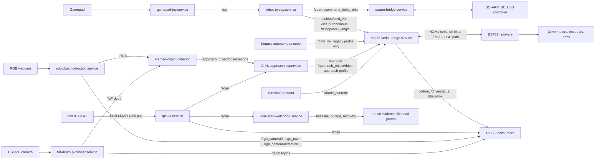
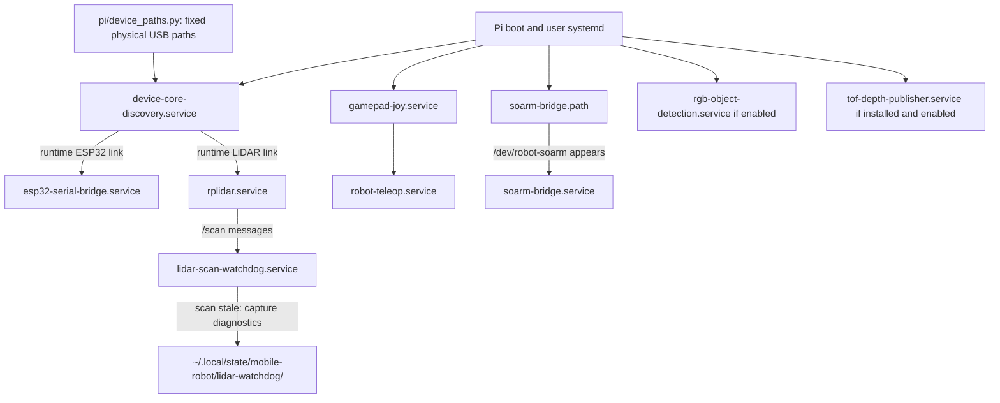

# Robot system architecture

This page shows the robot's runtime components. For installation commands and fixed USB
paths, use the [Pi runtime guide](../../pi/README.md); for building and
flashing, use the [main README](../../README.md#build-esp32-firmware).

## Named floor-object approach — REQUIRES_HARDWARE_TEST

The current task is to find a stationary **bottle or cup on a level floor**, check
up to two tilt views, approach on a clear path and stop **30 ±5 cm from the nearest
surface, measured from the robot's front edge**. SLAM, exploration and pickup are
outside this task. Notify the operator before issuing any base or camera-tilt
motion command.

Implementation lives in `pi/approach_object` and `pi/approach_object_interfaces`.
The detector subscribes to the existing RGB/ToF publishers; it never opens a
camera or commands the base. It uses YOLO11n-seg masks at 320 pixels, erodes mask
boundaries, projects millimetre ToF samples through measured intrinsics and
extrinsics, and rejects invalid, floor-contaminated or inconsistent samples.
Range interpretation (`optical_z` versus `radial`) must be measured. A nearest
reliable surface estimate subtracts the measured base-frame front edge.

The supervisor runs at 20 Hz. `/approach_object/start` accepts `bottle` or `cup`;
`/approach_object/cancel` stops the task. `/approach_object/status` is JSON with
state, target, clearance in metres, view and reason. Search holds the base still,
waits for measured settling, and requires three fresh observations. It selects
the matching object closest to image centre and retains its identity; ambiguous
associations fail. State flow is IDLE → SEARCH → ALIGN → APPROACH → STOPPED, with
latched FAILED/CANCELLED states. Target/depth loss, stale perception, lidar
blockage and teleop takeover require explicit restart. No retries or reversals.

The bridge's `approach_mode:=true` profile removes its `/cmd_vel` subscription.
Only stamped `/approach_object/drive` requests enter the autonomous path, with a
250 ms local lease and 50 ms expiry checks. Expiry sends zero and stays latched
until an explicit operator mode cycle. `/drive/approach_authority` reports the
bridge gate. Starting a task never selects autonomous mode. Teleop, mode override,
neck and arm interfaces remain available. This controls ordinary ROS command
routing; access to the trusted ROS domain remains an operator responsibility.
The firmware's existing one-second timeout remains the fallback if the entire
serial bridge fails; bridge-local expiry covers supervisor failure.

### Calibration and movement gate

`config/calibration.yaml` ships with `enable_motion: false`, missing measurements
and all qualification flags false. Start requests fail until measured calibration
is provided. The two provisional servo commands (90°/130°) are within 80–150°;
they are **not measured camera pitches or qualified viewing angles**. No base
motion, firmware flashing or live service changes were performed for this task.
Camera tilt was later exercised at the operator's explicit request (see results).

Record RGB/ToF K matrices and distortion, optical ToF→RGB transform, optical
ToF→base transforms at both views, settling times, image buffering bound, depth
range semantics and validated limits. Base coordinates are x forward, y left,
z up; optical coordinates are x right, y down, z forward. Rigid transforms map
column-vector source points into destination coordinates. Record the front edge,
lidar→base transform, full-circle scan coverage, corridor half-width/front limit
and the complete turning swept radius. Unknown forward lidar beams block motion;
turning additionally requires valid coverage around the robot.

Independently measure the signed forward/left-turn serial command mappings,
actual speed (at most 0.05 m/s), braking travel and distance uncertainty. Command
values are not assumed to be metres per second. Positive drive previously moved
backwards; do not infer polarity or reuse failed automatic distance tests.
Uncertainty must cover travel during the maximum 500 ms perception age, 250 ms
lease and 50 ms supervision delay. Braking plus uncertainty must fit the 5 cm
stopping allowance; otherwise reduce speed/latency. Benchmark flags alone cannot
qualify the camera pose, tape distance or final stopping accuracy.

Before enabling movement, exercise both camera views with motor output physically
blocked, including absent/multiple targets, camera/depth loss and process death.
Validate stationary object clearance against tape measurements, especially near
30 cm. Then use short operator-observed movements to qualify polarity, turning
and braking before bottle/cup approaches, cancellation, takeover and blocked-path
checks. Record every measured configuration, result and failure here. Final
acceptance still requires centred target, no contact, no unintended reversal and
explicit restart after faults.

### Build, model export and launch

On the Pi, keep the detector environment separate from capture services:

```bash
python3 -m venv --system-site-packages ~/homer-approach-venv
~/homer-approach-venv/bin/pip install -r ~/mobile-robot/pi/approach_object/requirements-pi.lock
source /opt/ros/jazzy/setup.bash
mkdir -p ~/homer_approach_ws/src
cp -a ~/mobile-robot/pi/approach_object ~/mobile-robot/pi/approach_object_interfaces ~/homer_approach_ws/src/
cd ~/homer_approach_ws
colcon build --symlink-install --packages-select approach_object_interfaces approach_object
source install/setup.bash
```

The workstation export uses `requirements-workstation.lock` (CPU Torch wheels
from `https://download.pytorch.org/whl/cpu`). Download the Linux binary from
[PNNX 20250912](https://github.com/pnnx/pnnx/releases/tag/20250912), place `pnnx`
in a separate export directory, make it executable, and run
`pi/approach_object/tools/export_model.py` using that environment. The script
checks source weights and PNNX hashes before export. Model hashes/revisions are
recorded in `config/model-manifest.json` and checked by `model_pin.py`; binary
artifacts are kept outside Git. NCNN export support is described by
[Ultralytics](https://docs.ultralytics.com/integrations/ncnn/).

Staged Pi model: `~/homer-approach-models/yolo11n-seg_ncnn_model`.
Read-only benchmark command (does not open cameras or publish commands):

```bash
source /opt/ros/jazzy/setup.bash
PYTHONPATH=~/homer_approach_ws/src/approach_object:$PYTHONPATH ~/homer-approach-venv/bin/python ~/homer_approach_ws/src/approach_object/tools/benchmark.py ~/homer-approach-models/yolo11n-seg_ncnn_model --image ~/homer-evidence/approach-object/rgb.png --output ~/homer-evidence/approach-object/benchmark.json
```

For later supervised deployment, copy the reviewed bridge and `autonomous_lease.py`
together to `~/mobile-robot/pi`. Install `tools/bridge-approach.conf` as
`~/.config/systemd/user/esp32-serial-bridge.service.d/approach.conf`, reload systemd
and restart the bridge only after notifying the operator. Preserve any existing
service/network overrides. Capture-owner timestamp improvements in RGB and ToF
are staged source changes; deploy them with the same capture services, never a
second capture process.

Launch the two task processes after sourcing the detector environment and ROS
workspace. Operator notification is required before a qualified start because
search commands camera tilt:

```bash
source ~/homer-approach-venv/bin/activate
source /opt/ros/jazzy/setup.bash
source ~/homer_approach_ws/install/setup.bash
ros2 launch approach_object approach.launch.py model:=$HOME/homer-approach-models/yolo11n-seg_ncnn_model calibration:=$HOME/homer_approach_ws/src/approach_object/config/calibration.yaml
ros2 service call /approach_object/start approach_object_interfaces/srv/StartApproach '{target: bottle}'
ros2 service call /approach_object/cancel std_srvs/srv/Trigger '{}'
```

With the shipped configuration the start service refuses movement. Use a copied,
measured configuration for qualification; never enable by changing flags alone.
The launcher does not start a second serial bridge or change operator mode.

Rollback: cancel the task and stop its two processes, select operator teleop,
remove only the `approach.conf` drop-in, reload systemd and restart the bridge.
Restore the saved capture-owner/bridge source versions if deployed. No firmware
changes are required. The staged code has not been installed into live services.

### Results and outstanding qualification (2026-10-04)

Feature branch: `approach-named-floor-object`, based on `origin/main` at
`dc666cc`. ROS Jazzy packages built on the Pi. Hardware-free tests exercise the
real bridge/service handlers with fake plumbing and synthetic sensor messages;
46 task tests plus 5 existing RGB/protocol regression tests passed on the Pi. Tests cover depth units/projection, contamination,
identity ambiguity, state transitions, cancellation, stale inputs, lidar coverage,
command expiry, bypass prevention, model checksums and image stride/endianness.

Existing RGB and ToF capture owners remain active. RGB stamps now occur directly
after retrieval, before HSV processing; ToF stamps occur before buffer copying.
Actual acquisition-to-retrieval buffering remains unmeasured. Pi evidence is in
`~/homer-evidence/approach-object/`. The operator restarted the Pi during an interrupted work
session; subsequent service checks were active. A pre-restart temperature spot
check reached 81.8°C; after restart it was 60.9°C with `throttled=0x0`.

Separately from the operator restart, initial inference failed with native
segmentation faults on both workstation and Pi (confirmed process exit 139). The exporter had downloaded a current PNNX binary while the first runtime
pin was NCNN 20250916; generated code required a newer batch-index API. Export
now pins PNNX 20250912 and NCNN 20260526. NumPy is pinned to 1.26.4 to remain
compatible with the installed Arducam SDK. Live capture environments were not
modified. The corrected export runs successfully on both machines. In a 30-sample Pi
benchmark of a frame from the existing RGB publisher, inference median was
**0.473 s** and p99 **0.988 s**, before capture buffering or transport. Temperature
rose from 61.3°C to 67.7°C; `throttled=0x0` before and after. Raw timings and model
revision are in `pi/approach_object/config/benchmark-pi.json`. This exceeds the
500 ms perception limit: **LATENCY_BLOCKER — movement must remain disabled**.
These limited samples do not qualify sustained runtime latency. The stationary
image benchmark does not prove bottle/cup recognition in both physical views.

A bounded live recognition preview subscribed to the existing camera without
starting the supervisor or serial bridge. No bottle was detected initially; the operator then placed a black bottle
and explicitly requested camera tilt. Commands 80° and 150° were issued with
advance notification and a provisional five-second settling pause. Saved frames
show that 80° points down and includes the bottle, while 150° points upward and
excludes it. The camera was returned to 80° with advance notification. These
observations establish viewing direction only, not measured optical pitch.

YOLO11n-seg at 320 did not confirm the bottle in either live preview. An offline
comparison of the 80° frame found a weak `vase` detection (~0.19 NCNN / ~0.14
PyTorch), with no bottle detection even at a diagnostic 0.05 confidence threshold.
PyTorch at 640 also failed to identify the bottle. The current pretrained model
therefore has a **RECOGNITION_BLOCKER for this black bottle**; do not relabel a
vase as a bottle or enable approach. Images/logs are
`~/homer-evidence/approach-object/view-80.*` and `view-150.*`. This is not a two-view or motion
qualification. For stationary previews, run the detector with
`--ros-args -p recognition_target:=bottle` (or `cup`), plus the calibration/model
parameters. Preview mode publishes observations only and cannot issue drive or
neck commands.

### Detector literature search and stationary screening — 2026-10-04

The operator requested a reliable, fast alternative after the black bottle was
misclassified. Selection considers instance masks, actual target recognition,
ARM deployment, and the existing 500 ms acquisition-to-decision limit. Published
GPU FPS, mean latency, and COCO AP do not establish reliability or latency on
Homer's Pi 4. No motion commands or changes to live Pi services were made during
this search. The installed movement model and its qualification gates remain
unchanged.

| Candidate | Primary evidence | Suitability and limits for Homer |
| --- | --- | --- |
| YOLO26n-seg | [Author paper, Table S9](https://arxiv.org/html/2606.03748v1): at 640, nano E2E mask AP 33.9 versus YOLO11n-seg 32.0; CPU ONNX 53.5 versus 65.9 ms. | Small segmentation candidate with a modest published improvement, not a guarantee for this bottle. CPU figures are Intel Xeon, not Pi measurements, and exclude NMS. [Pi guide](https://docs.ultralytics.com/guides/raspberry-pi) supports NCNN; its 67.03 ms result is Pi 5 **detection**, excluding preprocessing/postprocessing, not Pi 4 segmentation. |
| YOLOE, including YOLOE-26n-seg | [YOLOE paper](https://arxiv.org/html/2503.07465v2) describes text, visual and prompt-free detection/segmentation; its speed evaluations use T4/TensorRT and iPhone/CoreML. [Current official implementation](https://docs.ultralytics.com/models/yoloe/) supports reference boxes and export with fixed prompt embeddings. | Best demonstrated alternative for **this particular bottle**: an operator-confirmed visual example avoids depending on the failed generic bottle/vase classifier. It requires an explicit reference-selection step; visual matching alone does not fulfil autonomous named-class recognition. Text prompting is a separate untested candidate. Pi export and latency remain unqualified. |
| RF-DETR / RTMDet | [RF-DETR paper](https://arxiv.org/abs/2511.09554), [deployment documentation](https://rfdetr.roboflow.com/latest/learn/deploy/), and [RTMDet paper](https://arxiv.org/abs/2212.07784) provide real detector baselines and deployment routes. | Credible comparisons if offboard compute is considered. Their quoted GPU speeds do not establish Pi 4 suitability. Neither was tested on this bottle; do not replace the current model merely on benchmark rankings. |
| AprilTag 3 | [IROS 2019 paper](https://april.eecs.umich.edu/papers/details.php?name=krogius2019iros) and [official implementation](https://github.com/AprilRobotics/apriltag) describe a fast C detector, encoded identities and pose estimation. | Preferred controlled demonstration alternative **if the operator accepts a printed tag** rigidly attached to the target. This identifies the tag, not an arbitrary unmarked bottle/cup. Require visible, sufficiently large tags; calibration and tag-to-nearest-object-surface geometry still matter. No tag or Pi latency test was performed. |

Stationary screening used two separately captured, nearly identical downward
frames and one upward frame excluding the target, at 320 and 640 pixels. The
workstation environment uses Ultralytics 8.4.173, isolated from the pinned robot
environment. Diagnostic threshold 0.05 exposes weak predictions; it is not a new
movement threshold. YOLO11s-seg at 640 detected the actual bottle with score
0.5298 in the first downward frame, but only 0.3413 in the separately captured
return frame (below the existing 0.5 threshold); at 320 it labelled the target a
vase. YOLO11m-seg and YOLO26n/s/m-seg did not identify the actual bottle at either
input size. YOLO26n also produced a weak, incorrect bottle detection in the
upward frame at 320 (0.2284). Increasing size/resolution alone did not produce
consistent target recognition at the existing threshold.

YOLOE-26n-seg used a manually checked reference box `[215,239,339,434]` from
`homer-view-80.png`, then matched the bottle in **another image**,
`homer-returned-80.png`, with scores 0.9677 at 320 and 0.9730 at 640. The predicted
boxes cover the bottle. Both upward-view runs returned no detections even at
0.05. These are model scores, not calibrated correctness probabilities. This is
one positive scene and one negative scene, not a reliability study: no cup,
other bottle, distractor, distance, lighting, occlusion or sustained tracking
qualification was performed. A first visual-prompt call failed with a predictor
type mismatch; explicitly selecting `YOLOEVPSegPredictor` resolved it.

Reproduce these read-only checks with `pi/approach_object/tools/screen_detector.py`
in the isolated workstation environment, supplying reviewed local checkpoints.
It records image/checkpoint SHA256, dependencies, detections and wall times;
the times include initialization/reference work and concurrent CPU load and
**are not Pi latency benchmarks**. Raw screening evidence is in
`pi/approach_object/config/detector-screening.json`; images remain in the Pi's
existing evidence directory rather than committing room photographs.

Example for the visual alternative:

```bash
python pi/approach_object/tools/screen_detector.py \
  --model /path/to/yoloe-26n-seg.pt \
  --reference /path/to/homer-view-80.png --box 215 239 339 434 \
  --image /path/to/homer-returned-80.png --image /path/to/homer-view-150.png \
  --output /tmp/visual-screening.json
```

Recommendation: evaluate YOLOE visual reference matching next for this specific
object; if keeping autonomous `bottle`/`cup` class selection, evaluate text
prompting and fine-tune a small segmentation model on labelled robot-camera
bottles/cups and confusing objects. Separate training and evaluation by capture
session/object, not adjacent video frames. Measure target precision/recall,
wrong-instance selection, mask/depth contamination and full Pi latency before
changing the movement model. An independent [replication study](https://arxiv.org/abs/2405.06911)
also finds that accuracy and speed claims require comparable evaluation and can
degrade on limited compute. Tracking cannot make an initially incorrect class
correct. If no candidate meets both recognition and age limits, consider
offboard inference with acquisition timestamps and the existing Pi-local lease
supervisor; a network failure must still stop the base. AprilTag remains a
conditional alternative, not a silent change to the unmarked-object task.

### YOLOE bottle mask and RGB/ToF capture — 2026-10-04

Operator selected YOLOE and confirmed **both cameras tilt together**. Treat the
pair as a rigid mount: measure RGB/ToF intrinsics and one optical ToF→RGB
transform, then measure ToF→base at each useful tilt view. Verify that the mount
remains rigid across tilt changes; servo commands alone do not supply that pose.

Added `tools/capture_rgb_tof.py`, which only subscribes to existing image topics
and saves a fresh pair with acquisition stamps, frame IDs and raw millimetre
depth. Added `tools/yoloe_depth_preview.py`, a workstation-only reference matcher
using the checked YOLOE-26n-seg checkpoint. It saves the bottle mask and annotated
RGB image, and uses the same projection/filtering code as the approach detector
for a calibrated ToF-point overlay and front-edge clearance. It has no ROS or
command authority and does not replace the autonomous detector yet. Movement
qualification remains independent of this stationary diagnostic.

A new stationary capture had RGB/ToF timestamp separation **43.56 ms**. YOLOE
found one reference match, score **0.9654**, box approximately
`[215,241,337,429]`; the inspected mask covered the actual bottle. Distance was
explicitly withheld (`clearance_m: null`): intrinsics, alignment, depth range
interpretation, tilt poses and robot front-edge offset remain unmeasured.
No camera or base motion was commanded. Files are on the Pi under
`~/homer-evidence/approach-object/yoloe-depth/` and locally under
`/tmp/homer-yoloe-depth/`. The first capture invocation exposed a ROS callback
signature incompatibility with deque.append; wrapping callbacks fixed it, and
the subsequent live capture succeeded. Projection/depth safety tests: 28 passed.

Run capture with the existing ROS/network environment sourced on the Pi:

```bash
python3 tools/capture_rgb_tof.py --output /tmp/bottle-capture
```

Copy that directory to the workstation. In the isolated Ultralytics 8.4.173
screening environment, include `pi/approach_object` on PYTHONPATH and run:

```bash
python pi/approach_object/tools/yoloe_depth_preview.py \
  --model /tmp/homer-detector-models/yoloe-26n-seg.pt \
  --reference /tmp/homer-view-80.png --box 215 239 339 434 \
  --capture /tmp/bottle-capture \
  --calibration pi/approach_object/config/calibration.yaml --view 0
```

`--view` must describe the measured capture pose before using distance. The
current placeholder calibration intentionally produces only a recognition
image, without a fabricated depth overlay or distance. Next: calibrate and
inspect projected depth on bottle, floor and background, then compare the
nearest-surface/front-edge estimate with tape measurements at several ranges
including 30 cm. Keep `enable_motion: false`. Rollback: stop these diagnostic
commands; they do not alter live capture services or control processes.

### Nominal field-of-view overlap — 2026-10-04

Operator clarified that overlap means **viewing geometry**, without cross-image
feature matching, and requested proceeding without physical measurement.
`tools/fov_overlap_preview.py` now draws nominal ToF frustum footprints on RGB
at 0.5, 1 and 2 m optical depth and projects raw ToF samples into the YOLOE mask.
No feature detector or image registration is used. The preview has no command
authority and never reports verified robot-front clearance.

USB enumeration confirms Logitech C930e. Its [manufacturer datasheet](https://secure.logitech.com/assets/47868/logitech-webcam-c930e-data-sheet.pdf)
specifies 90° diagonal FOV. The [Arducam overview](https://docs.arducam.com/Raspberry-Pi-Camera/Tof-camera/TOF-Camera/)
lists 70° diagonal FOV for the 240×180 camera family; its product row also lists
different horizontal/vertical angles, so the exact lens/mode remains unverified.
The existing measured robot URDF puts RGB and ToF centres 0.04 m apart along
the camera bar. Diagnostic assumptions are parallel optical axes, centred
uncropped pinhole images, nominal family FOV and radial millimetre ToF range.
They do not replace calibrated intrinsics/extrinsics. In particular, current
640×480 webcam cropping/zoom and optical alignment have not been established.

```bash
PYTHONPATH=pi/approach_object python pi/approach_object/tools/fov_overlap_preview.py \
  --capture /tmp/homer-yoloe-overlap \
  --rgb-diagonal-deg 90 --tof-diagonal-deg 70 --baseline-x-m .04
```

To inspect sensor quality, the existing ToF capture owner now also publishes raw
SDK amplitude and confidence on `/tof_camera/amplitude/image_raw` and
`/tof_camera/confidence/image_raw`, with the depth acquisition stamp. SDK support
was checked locally and against [Arducam's API](https://www.arducam.com/docs/tof-camera-getting-started/API/Python_API.html).
The updated publisher was copied to the Pi and only
`tof-depth-publisher.service` was restarted. RGB/control services were untouched;
no camera/base/arm motion was commanded. `capture_rgb_tof.py --auxiliary` requires
these streams from the same depth frame, while retaining the 80 ms RGB/ToF gate.
The fresh capture passed at **65.52 ms** separation, and YOLOE again selected one
bottle mask (score **0.9634**).

Depth, amplitude and confidence previews all appeared noise-like. Approximately
29.6% of raw depth pixels were exactly zero; repeated 500 mm increments dominate
the nonzero values. Nominal projection selected 3026 samples inside the eroded
bottle mask, with 5th/median/95th percentiles **0.5/2.0/3.5 m**. These are raw
diagnostic statistics, **not a bottle distance**. Therefore next work is to
diagnose ToF acquisition/SDK/configuration before using FOV overlap for ranging.
No sensor failure cause has yet been established. Evidence is under
`~/homer-evidence/approach-object/yoloe-overlap/` on the Pi and
`/tmp/homer-yoloe-overlap/` locally. Workstation task tests: 34 passed, 2 ROS-only
skips; live auxiliary capture succeeded. Roll back the publisher if needed:

```bash
cp ~/homer-evidence/approach-object/tof-publisher-before-auxiliary.py \
  ~/mobile-robot/pi/tof_depth_publisher.py
systemctl --user restart tof-depth-publisher.service
```

All physical calibration, motor-blocked two-view qualification, measured drive
commands, tape checks and physical approaches remain outstanding.
**REQUIRES_HARDWARE_TEST** remains in force; no base-motion commands have been
issued. Only the explicitly requested and announced camera-tilt checks ran.

### Direct ToF diagnosis — 2026-10-04

With no base, arm or camera motion, the existing ToF owner was briefly stopped
for exclusive SDK checks and restored after each check. CSI `/dev/video0` is
`unicam-image`, separate from the Logitech USB camera. Python SDK and native
ToF library both report **0.1.24**, also the installed repository's current
candidate. The camera reports HQVGA, 240×180, 12-bit, two bytes per raw sample.
The Pi reported `throttled=0x0`. The operator confirmed that both a separate
power cable and the CSI ribbon are connected; supply voltage/current have not
been measured.

Ten copied depth/amplitude/confidence frames were recorded after five warm-up
frames for each of default, 2000 mm and 4000 mm range. The SDK accepted both
range settings, but none recovered a usable scene. Median amplitude was 8 and
its 95th percentile about 17.89; only **0.025–0.026%** of pixels exceeded 30.
This is a diagnostic comparison, not a qualified HQVGA validity threshold.
Changing range halved the depth values without recovering the signal. Thus the
noise exists **before ROS transport and RGB projection** and is not confined
to the bottle's mask. Ten raw frames were also saved; the last was a 720×240
int16 array with 5th/median/95th percentiles −240/−16/208. No definitive cause
(illumination, obstruction, power, sensor configuration or driver) is established.

Evidence: `~/homer-evidence/approach-object/tof-sdk-check/` on the Pi contains
`sdk-check.json`, per-range arrays, `raw-check.json` and `raw.npy`.
`tof-depth-publisher.service` was confirmed active after restoration; RGB and
control services were untouched. Next discriminating check is a stationary
bright diffuse surface held within the ToF view, without moving the robot or
changing cables. This requires no tape measurement. No distance or movement
qualification gate has been enabled; **REQUIRES_HARDWARE_TEST** remains.
Arducam documents the supported range controls in its
[SDK controls reference](https://www.arducam.com/docs/tof-camera-getting-started/Example/controls.html).

### White-surface response check — 2026-10-04

The operator placed a white lined sheet in front of the cameras. RGB capture
visually confirmed the sheet covers most of the image. Three fresh synchronized
RGB/ToF captures had separations of 31.48, 13.43 and 18.61 ms. All three ToF
images retained noise-like structure: depth 5th/median/95th percentiles were
0/1000/3500 mm, and amplitude percentiles were 0/8/17.89, essentially unchanged
from the bottle-only scene. Only 0.030–0.032% of amplitude samples exceeded 30
(diagnostic statistic, not an established validity gate). The white surface
therefore did not recover a usable depth image in this setup. Exact placement
within the ToF frustum has not been independently verified.

This weakens the dark-bottle-only explanation; illumination/power delivery,
obstruction, sensor configuration and driver remain unconfirmed possibilities.
A connected separate power cable does not establish voltage at the sensor.
No hardware failure is declared. Evidence is in the Pi directories
`~/homer-evidence/approach-object/tof-white-surface{,-2,-3}/`; the first capture
is also in `/tmp/homer-tof-white-surface/` locally. These checks used only ROS
subscriptions: no service changes or base/arm/camera motion commands.

## Data and control flow



The ESP32 bridge routes either `/teleop/cmd_vel` or `/cmd_vel` according to
the selected mode; `/mode_override` takes priority. The ESP32 has a one-second
motor-command timeout. The SO-ARM bridge starts only when `/dev/robot-soarm`
appears. The ToF publisher source is now tracked in `pi/tof_depth_publisher.py`.
The RGB service can be disabled for diagnosis and is not required for LiDAR
scans. The ToF path is optional when its separate service is installed.

## Boot and fault observation



Discovery checks paths without opening serial devices. The ESP32 bridge opens
only its fixed port; the LiDAR driver alone opens the LiDAR port. The watchdog
starts with the Pi, allows 60 seconds for startup, then reports 15 seconds
without `/scan`. It takes a healthy baseline and, during an outage, saves at
most one snapshot per minute (latest 30 retained). Each snapshot includes
service states, ROS graph, serial ownership, USB state, Pi temperature and
throttling, relevant processes, and recent logs. Recovery is logged, but the
watchdog does **not** restart anything.

Check the live system with `systemctl --user status lidar-scan-watchdog.service`
and `journalctl --user -u lidar-scan-watchdog.service -b`. The [Pi runtime
guide](../../pi/README.md#device-identities-and-usb-safety) lists the exact
device paths and safe verification commands.
