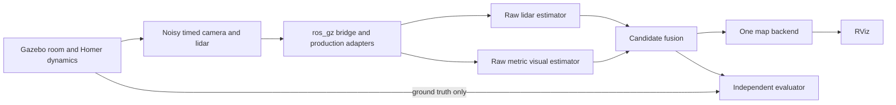

# Simulation-first SLAM validation with a small reality gap

Latest execution decision (2026-10-04): the user deferred simulation. Follow
the [real-world MVP sequence](slam-rviz-navigation-fast-mvp-plan.md). Earlier
simulation prerequisites are historical; evidence and physical qualification
requirements still apply.

User requirement recorded 2026-10-04: test in simulation before deployment.
Applies to proposed SLAM/fusion and motion changes. The later
[live SLAM/RViz goal plan](live-slam-rviz-goal-navigation-plan.md) brings Nav2
simulation into scope and supersedes the RGB-D assumptions below with the
current RGB/lidar-only configuration. No remote automatic driving tests continue. The [camera–lidar review](slam-camera-fusion-literature-review-2026-10-04.md)
sets out the candidate estimators and hardware prerequisites.

## Recommended setup

Use **Gazebo Harmonic + ROS 2 Jazzy** on the laptop, the existing Homer URDF,
and one small textured room resembling the physical test area. Bridge camera,
laser and clock data into the real ROS estimator code; use the same parameters,
frames and QoS as deployment wherever applicable. Gazebo documents this ROS/Gazebo
pairing and `ros_gz` integration.
[Official installation pairing](https://gazebosim.org/docs/harmonic/ros_installation/),
[ROS bridge](https://gazebosim.org/docs/harmonic/ros2_integration/).

Gazebo alone is not enough: combine controlled simulation with replay of real
Homer sensor data. Replay reproduces actual textures, USB timing, invalid scans
and camera artefacts that are hard to model. It cannot evaluate a changed
controller's resulting physical trajectory; simulation handles that part.

## Audit of what already exists

`simulation/pybullet_sim.py` is a useful geometry/workspace and simple lidar tool,
but its base is moved using `resetBasePositionAndOrientation`, not calibrated
wheel dynamics. It does not provide the needed synchronized ROS RGB/depth/lidar
fusion test environment. Its lidar defaults to 8 m, and its track width is 0.230 m.
The canonical URDF wheel centres are 0.320 m apart; firmware's nominal track is
0.330 m. These disagreements must be reconciled against the actual robot before
claiming comparable motion.

The current URDF contains collision and visual geometry but no `<inertial>`
blocks. It must be supplemented with measured/estimated masses, inertias,
wheel/contact properties and a stowed arm configuration for a dynamics model.
Do not present placeholder mass or friction as measured calibration.

`pi/homer_slam/test/ros_smoke.py` checks stationary synthetic scans, graph
ownership, save/reload and stale-data behaviour in isolated ROS domain 71. It
uses 720 rays and 8 m scans at 10 Hz, so it is not a realistic LDS-01 moving
accuracy test and cannot certify camera fusion or physical stopping.

Keep these tools. Add a dedicated simulation package/profile rather than
silently changing their original purposes. This document plans that addition;
the Gazebo model/bridge/test runner have not yet been implemented or installed.

## The smallest useful simulator

1. A floor, four walls, a doorway, one box/table and several textured surfaces
   visible to the high camera. Include a plain-wall version so vision can fail.
   Approximate the physical room's dimensions; do not begin with a photorealistic
   building or a full exploration system.
2. Homer base, wheels, casters, mast, stowed arm, fixed head, actual sensor
   locations and calibrated camera optical axes. Use the canonical URDF as the
   starting geometry, with temporary LDS-01 scan-centre override when verified.
3. A 360-ray horizontal scan at roughly 5 Hz and 0.12–3.5 m metadata, matching the
   temporary lidar. Model invalid/no-return readings, range-dependent noise and
   the sweep's acquisition timing instead of assuming an instantaneous scan.
4. RGB rendered using measured C930e resolution, rate, intrinsics and distortion
   behaviour; a separate 240×180 depth camera with the measured ToF field of view,
   calibrated relative pose and invalid-pixel mask. Use the same explicit unit
   conversion/registration pipeline in simulation as on hardware.
5. The production SLAM/odometry executables unchanged, with `use_sim_time=true`.
   Exactly one simulated `/clock` and correct TF ownership.
6. Separate `/ground_truth/base_pose` for scoring. Never feed simulator truth
   odometry, perfect depth outside real ToF coverage, or an ideal robot pose into
   the estimator/controller under test.

Illustrative ROS flow:

## Match the failures that matter

**Motor interface:** the real firmware maps Twist values through linear scale
220 and angular scale 637.5 into clamped PWM duty. Its command is not closed-loop
metric velocity. A Gazebo diff-drive plugin accepting ideal m/s directly would
hide that gap. For control tests, reuse the actual command conversion/mode/
watchdog logic through a host-testable controller or HOM1 serial emulator and
apply its signed wheel outputs to a calibrated motor model. The emulator must
match reconnect and mode behaviour; a fresh reimplementation is not equivalent
without parity tests.

Start the motor model with bounded uncertain parameters: deadband/stiction,
left/right response, battery dependence, saturation, acceleration, coasting,
braking, direction sign and caster/friction effects. The observed polarity is
an explicit regression case, not a guessed permanent reversal fix. Unknown
parameters remain uncertainty ranges; simulation cannot certify a motor model
whose real response is unmeasured. Sensor-only SLAM tests can first use known
trajectories without enabling a motion controller.

**Timing:** collect timestamp age, receive intervals, buffering and dropped-frame
statistics. RGB and ToF currently stamp at processing time; a recent ROS stamp
can conceal old captured data. Carry capture time where available and otherwise
measure/bound its offset. Vary transport delay, processing stalls and Pi-equivalent
compute load, and measure at RViz as well as at the estimator. Reproduce the
read-only SSH viewer when testing its display latency.

**Calibration:** perturb sensor translations/rotations and camera intrinsics
within measured uncertainty. Compare low laser-plane/high-camera geometry and
limited depth overlap. Keep the head fixed until a measured dynamic transform
is supported. Reusing the URDF does not remove calibration uncertainty.

**Appearance and range:** test textured rooms, feature-poor walls, lighting/exposure
changes, image blur, repetitive corridors, moving people and scan occlusion.
If a camera loses tracking, fusion should report reduced confidence or stop
providing a motion-valid estimate; it must not silently continue with trusted
RF2O after the observed failure.

System identification, actuator modelling and latency are supported transfer
principles in Tan et al.'s 2018 locomotion research. Its quadruped results do not
prove transfer on Homer; applying the principles here is an engineering inference.
[Paper](https://arxiv.org/abs/1804.10332).
Tobin et al. (2017) demonstrate randomized rendering for visual transfer. For
this classical SLAM task, varying textures/lighting is a proposed robustness test,
not evidence that randomization alone guarantees accurate odometry.
[Paper](https://arxiv.org/abs/1703.06907).

## Validation stages

| Stage | What runs | Pass evidence | Hardware motion |
| --- | --- | --- | --- |
| A. Interface regression | Simulation clock/TF, units, sensor rates and real command/mode logic | Correct frames/units; no duplicate TF owners; correct polarity; zero on timeout | None |
| B. Sensor-only tracking | Known simulated trajectories, lidar baseline, visual baseline and fusion | Metric motion and uncertainty agree with independent truth | None |
| C. Closed-loop simulation | Actual motion logic against uncertain motor model | Bounded travel, correct direction, zero on cancel/loss/takeover; no automatic end reversal | None |
| D. Real-data replay | Recorded raw Homer sensors, calibrated transforms and independent tape/marker references | Comparable results under real timing and appearance; regression failures retained | None during replay |
| E. Hardware shadow mode | Candidate estimates on real inputs, output disconnected from motors | Resource/latency checks; candidate agrees with independent reference | Operator only under a separate procedure |
| F. Deployment qualification | Previously qualified software/settings on hardware | Physical stopping and accuracy acceptance completed | Separate explicit procedure; simulation is not sufficient authorization |

For stages B/C, begin with 10-second stationary data, a true 30 cm straight
trajectory, a small turn and a return to start. Then run a small room loop and
failure cases. Use five fixed seeds per candidate for a modest first comparison,
with results retained individually. Larger rooms and exploration follow only
after these basic cases succeed.

Inject camera dropout, lidar dropout, stale-but-republished poses, unit/sign
errors, transport interruption and a command producer crash. Require that motion
logic refuses invalid estimates and never reverses at completion unless reverse
motion was explicitly part of the requested maneuver. Include a regression where
actual travel is 50 cm while the estimator reports 9 cm: a single bad estimator
must not be accepted as the sole distance limiter.

## Scoring and provisional targets

Targets below are engineering proposals, not published guarantees or test passes.
Use independent ground truth and preserve metric scale: align coordinate origin
and heading only, never fit a scale factor that hides 50 cm versus 9 cm.

- A true 30 cm sensor-only trajectory: endpoint translation error ≤3 cm, yaw
  error ≤3°, with tracking-loss flags and latency reported.
- Ten-second stationary quick check: report drift; retain the existing separate
  60-second <5 cm/<3° qualification when required. Do not turn a short check into
  a full pass.
- Closed-loop simulated 30 cm target: true travel 27–33 cm, no unintended reversal,
  and limits pass across the measured/uncertain motor and delay ranges. Simulator
  truth is for grading only, not the controller's stop input.
- Safety cutoffs: measured software-command age and estimator age ≤250 ms in
  nominal tests, and zero output within 250 ms after invalid input is detected.
  Report time until actual wheel stop and residual travel separately. The current
  one-second firmware timeout alone does not meet this proposed stricter gate.
- Map display: aim for ≤1-second occupancy updates and ≤250-ms nominal pose/scan
  receive age, with p95/max reported. A display-rate change is not an accuracy fix.
- Loop and return: measure both trajectory error and map wall alignment; preserve
  the existing <20 cm/<5° physical return requirement as a separate later gate.

Publish an acceptance report per candidate: exact code/config revision, calibration
version, input bag/world, seeds, CPU load, processing/transport age, tracking losses,
scale-preserving trajectory errors, stop latency and known limitations. Any failed
safety case blocks deployment. A nominal simulation pass does not erase unknown
motor calibration or replace physical qualification.

## First implementation section

The first deliverable is a **laptop-only moving sensor/estimator test**, with
no real motor connection: one room, canonical model with verified overrides,
realistic LDS-01 scans, calibrated camera inputs, isolated ROS domain, simulated
clock and independent ground-truth scoring. Reproduce the RF2O baseline on a known
30 cm trajectory before introducing fusion. Add RGB-D only after depth-unit and
registration checks. Add the uncertain drive emulator after sensor tests pass.

Use a Docker container with no Pi device mounts, no SSH command forwarding and
an isolated network/domain for simulated commands. A domain number alone is
insufficient isolation if an existing command relay or device connection bypasses
it. Keep replay drive/status topics remapped to an analysis namespace. Simulation
must never discover or command the live ESP32 bridge.
